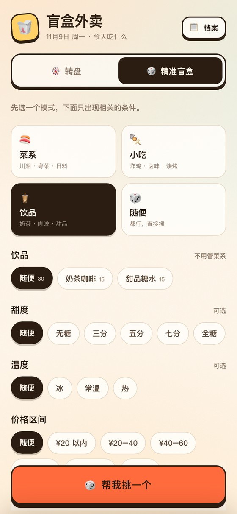

<h1 align="center">🥡 盲盒外卖</h1>

<p align="center">
  选择困难症救星：今天吃什么，交给转盘和一点运气。
</p>

<p align="center">
  <a href="https://hanny-0303.github.io/blind-box-takeout/"><strong>在线体验 →</strong></a>
  &nbsp;·&nbsp; 纯前端 &nbsp;·&nbsp; 零依赖 &nbsp;·&nbsp; 手机优先
</p>

<p align="center">
  
  &nbsp;&nbsp;
  
</p>

---

## 先选模式，再选条件

「精准盲盒」不再是一张长长的表单，而是四种模式。选完模式，下面只出现相关的条件。

| 模式 | 下面出现什么 |
| --- | --- |
| 🍣 菜系 | 菜系（随便 / 川湘 / 粤菜 / 江浙 / 西北 / 东北 / 日料 / 韩餐 / 东南亚 / 西餐）→ 主食（随便 / 饭 / 面 / 粉 / 米线 / 饺子 / 早餐）→ 口味 / 辣度 / 食材 / 做法 / 新鲜度 / 价格 |
| 🍢 小吃 | 小吃类型（炸鸡汉堡 / 卤味 / 烧烤 / 轻食）→ 口味 / 辣度 / 价格 |
| 🧋 饮品 | 饮品类型（奶茶咖啡 / 甜品糖水）→ 甜度 / 温度 / 价格 |
| 🎲 随便 | 新鲜度 / 价格 |

### 菜系模式

菜系和主食是两个可以组合的维度：

- 菜系 = 川湘 + 主食 = 面 → 重庆小面、川味凉面
- 菜系 = 川湘 + 主食 = 饭 → 水煮牛肉、回锅肉、麻婆豆腐盖饭
- 菜系 = 川湘 + 主食 = 随便 → 火锅、麻辣烫也会出现
- 菜系 = 随便 + 主食 = 面 → 热干面、重庆小面、兰州牛肉面

火锅、麻辣烫是「菜系专属」：只有主食选「随便」时才出现，主食选饭/面会被过滤掉。

### 小吃模式

只按小吃类型、口味、辣度、价格筛。小吃不需要先选菜系，也不会出现主食。

小吃一共 53 道，其中炸鸡汉堡 / 卤味 / 烧烤 / 轻食各 10 道；剩下的 13 道（寿司、虾饺、章鱼小丸子、辣炒年糕等）在「随便」里。

### 饮品模式

饮品下面是甜度和温度，不再出现口味、辣度、食材、做法：

- 甜度：随便 / 无糖 / 三分 / 五分 / 七分 / 全糖
- 温度：随便 / 冰 / 常温 / 热

<p align="center"></p>

### 随便模式

不挑菜系、不挑类型，只保留新鲜度和价格，适合“我什么都行”。

## 辣度是精确等级

选「微辣」就是微辣，不再包含不辣。口味选「随便」时，酸辣、麻辣、香辣只要那道具是微辣，都会出现。

只有真的没有菜时才会提示把条件放宽，不会提前说“口味和辣度冲突”。

## 菜品和标签

现在一共 **264 道菜**，每道菜都有两个标签：

- **类型**：主食 / 小吃 / 饮品 / 菜
- **菜系**：川湘 / 粤菜 / 江浙 / 西北 / 东北 / 日料 / 韩餐 / 东南亚 / 西餐 / 无

几个归属约定：

- 水煮牛肉、锅包肉、回锅肉、地三鲜 → 主食 / 饭（配饭菜）+ 菜系
- 重庆小面、川味凉面 → 主食 / 面 + 川湘
- 兰州牛肉面 → 主食 / 面 + 西北
- 鳗鱼饭、亲子丼、石锅拌饭、海南鸡饭 → 主食 / 饭 + 对应菜系
- 火锅、麻辣烫、部队锅、咖喱、披萨意面 → 菜系专属
- 寿司、虾饺、章鱼小丸子、炸鸡、辣炒年糕、春卷 → 小吃
- 奶茶咖啡 15 道、甜品糖水 15 道 → 饮品，带甜度/温度选项

数量分布：

- 菜系模式 181 道（主食 147 + 菜 34）
- 小吃 53 道
- 饮品 30 道

## 转盘和店铺

**🎡 转盘**
从 25 个细分分类里随机抽 16 道菜，凑成一圈候选。停下后给出 3 家能送到的店（演示数据），按平台评分从高到低排列。

**🏪 店铺**
点「去搜」会复制菜名并打开对应平台，粘贴搜索就能找同款。实际下单和支付都在官方 App 里完成。

> ⚠️ 店铺名、评分、时长都是演示数据，不是真实的美团/京东店铺。

**🗂️ 口味档案**
每次点「就吃这个」会记录菜品、价格、平台、店铺、评分和时间。点「再来」会把当时的菜和店重新放回结果页，店铺标「上次这家」。

<p align="center"></p>

## 关于真实店铺和自动下单

店铺评分需要美团/京东开放平台或联盟的资质与 API，静态网页拿不到，抓取也违反平台条款。真实接入需要官方 API key + 后端代理。

「输入支付密码自动下单」没有做，也不建议做：网页无法控制手机去操作美团/京东，也没有代下单权限；第三方收集支付密码有盗刷风险；不告知用户买什么就扣款也不合规。

所以这里只做到「推荐 + 跳转」：揭晓菜品和店铺 → 用户确认 → 去官方 App 下单付款。

## 本地运行

```bash
python3 -m http.server 8000
# 打开 http://localhost:8000
```

> 剪贴板 API 需要 HTTPS 或 localhost；用 `file://` 打开时，「去搜」的复制可能失败，但菜名会显示在提示条里。

## 项目结构

```
index.html          页面结构
styles.css          样式（移动端优先）
data.js             菜品库 + 类型/菜系/饮品标签
app.js              转盘、四种模式、筛选、店铺推荐、口味档案
favicon.svg         小图标
docs/               README 截图与分享封面
```

## 想加菜？

打开 `data.js`，往 `DISHES` 里加一行，再在文件末尾的标签表里确认它会被分到哪个类型：

```js
{
  id: 'r11', name: '青椒肉丝盖饭', short: '青椒肉丝', cat: 'bowl',
  spice: 1, price: 22, emoji: '🫑', desc: '家常但下饭',
  flavor: '咸香', protein: '猪肉', style: '小炒',
},
```

- `spice`：`0` 不辣 / `1` 微辣 / `2` 正常辣 / `3` 加辣
- `flavor`：`清淡 / 咸香 / 酸甜 / 酸辣 / 麻辣 / 香辣 / 鲜香`
- `protein`：`鸡肉 / 牛肉 / 猪肉 / 海鲜 / 素食`（其他食材用 `其他`）
- `style`：`带汤 / 干香 / 小炒 / 炸烤 / 凉食 / 蒸煮`
- `type` / `sub` / `cuisine` 由 `TYPE_BY_CAT`、`TYPE_OVERRIDES`、`CUISINE_BY_CAT`、`CUISINE_BY_ID` 决定

饮品还要在 `DRINK_OVERRIDES` 里补甜度/温度支持范围。

## 技术栈

原生 HTML + CSS + JavaScript，没有框架、没有依赖、没有构建步骤。转盘用 `<canvas>` 绘制，动画用 `requestAnimationFrame`，记录存在 `localStorage`。

---

<p align="center"><sub>用 ❤️ 和一点点运气做的 · 数据只存在你的浏览器里</sub></p>
