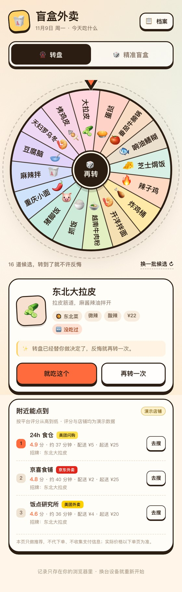
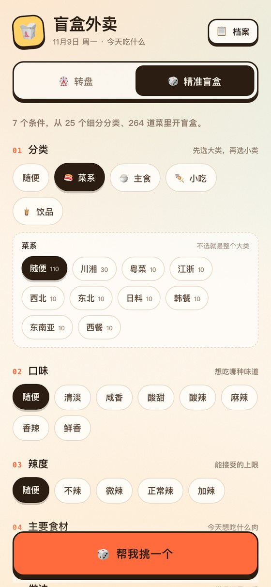
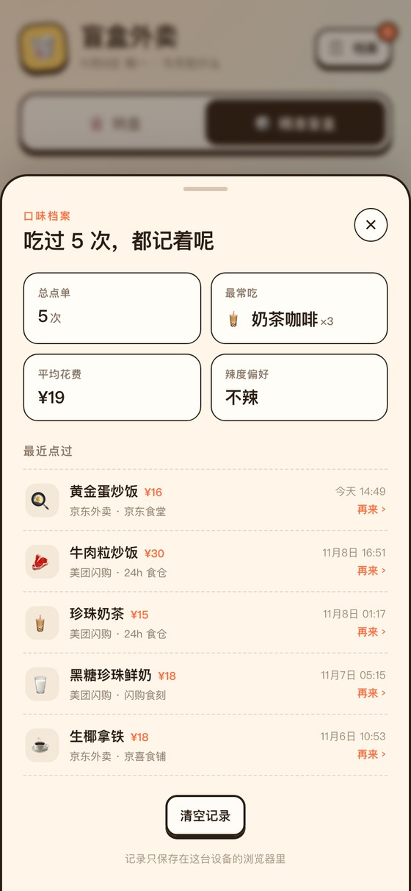

<h1 align="center">🥡 盲盒外卖</h1>

<p align="center">
  选择困难症救星：今天吃什么，交给转盘和一点运气。
</p>

<p align="center">
  <a href="https://hanny-0303.github.io/blind-box-takeout/"><strong>在线体验 →</strong></a>
  &nbsp;·&nbsp; 纯前端 &nbsp;·&nbsp; 零依赖 &nbsp;·&nbsp; 手机优先
</p>

<p align="center">
  
  &nbsp;&nbsp;
  
</p>

---

## 现在怎么玩

**🎡 转盘**
从 **25 个细分分类**里随机抽 **16 道菜**，凑成一圈候选，每格来自不同分类。点「开转」转盘转几圈，指针停在哪道就吃哪道。停下后会同时给出 3 家能送到的店（演示数据），按平台评分从高到低排列。

**🎲 精准盲盒**
分类是**两级**的：

1. 先选大类：菜系 / 主食 / 小吃 / 饮品；
2. 再选小类：比如菜系里的川湘、粤菜、江浙，主食里的饭、面、粉、米线；
3. 小类默认「随便」，不选就是整个大类。

二级只到**品类**，不列具体菜。选「菜系 → 江浙」后，具体吃红烧肉还是西湖醋鱼，仍然交给盲盒。

**口味**是独立条件，不和分类混在一起。这样「主食 → 面」还能叠加「口味 → 麻辣」，选到重庆小面、川味凉面这类。

点「帮我挑一个」后先给一个密封盲盒；点「揭晓答案」才展示菜品和店铺。换一个时：

- 还在密封状态：换一个新的密封盒，标题会变成「第 2 个 / 第 3 个盲盒已就绪」；
- 已经揭晓：直接换一道**新的菜**，并硬排除上一道；条件太窄只剩一道时会提示放宽。

**🏪 开盒店铺**
转盘停下或盲盒揭晓后，会列出 3 家「附近能点到」的店，按评分从高到低排序，标注平台（美团闪购 / 京东外卖 / 美团外卖）、评分、预计时长、配送费和起送价。

点「去搜」会复制菜名并打开对应平台，粘贴搜索就能找同款。实际下单和支付都在官方 App 里完成。

> ⚠️ **店铺名、评分、时长都是演示数据**，不是真实的美团/京东店铺，也不是真实评分。

**🗂️ 口味档案**
每次点「就吃这个」会记一笔：菜品、价格、平台、店铺、评分和时间。

点档案里任意一条「再来」，会把这个菜和当时的店铺重新放回结果页，店铺上标「上次这家」，想再吃就点「去搜」。

<p align="center"></p>

**✨ 新鲜度**
- **尝鲜**：点得越多的分类/菜品权重越低，没吃过的额外加权；
- **念旧**：常点的分类和菜品权重更高；
- **还没有记录时**：按「随便」处理，档案里可以一键生成 5 笔示例记录。

所有记录只存在浏览器的 `localStorage` 里，没有后端、没有账号、没有埋点。

## 分类怎么分

一级只有 4 个，点开才出现二级：

| 一级 | 二级（默认带“随便”） |
| --- | --- |
| 🍣 菜系 | 川湘 / 粤菜 / 江浙 / 西北 / 东北 / 日料 / 韩餐 / 东南亚 / 西餐 |
| 🍚 主食 | 饭 / 面 / 粉 / 米线 / 饺子 / 早餐 |
| 🍢 小吃 | 炸鸡汉堡 / 卤味 / 烧烤 / 轻食 |
| 🧋 饮品 | 奶茶/咖啡 / 甜品/糖水 |

几个归属上的约定：

- 火锅、麻辣烫归到「菜系 → 川湘」，所以川湘有 **30 道**（川湘菜 10 + 火锅 10 + 麻辣烫 10）；
- 烧烤归到「小吃 → 烧烤」；
- 包子归早餐，饺子/馄饨/锅贴/抄手留在「饺子」；
- 叉烧包留在粤菜；
- 二级每个选项都显示菜品数，比如「饭 20」「奶茶咖啡 15」。

菜品库现在是 **25 个细分分类、264 道菜**：

- 菜系 110 道
- 主食 84 道
- 小吃 40 道
- 饮品 30 道

## 条件一览

| 顺序 | 条件 | 选项 |
| --- | --- | --- |
| 01 | 分类 | 随便 / 菜系 / 主食 / 小吃 / 饮品（选完再出二级） |
| 02 | 口味 | 随便 / 清淡 / 咸香 / 酸甜 / 酸辣 / 麻辣 / 香辣 / 鲜香 |
| 03 | 辣度 | 随便 / 不辣 / 微辣 / 正常辣 / 加辣（按能接受的上限） |
| 04 | 主要食材 | 随便 / 鸡肉 / 牛肉 / 猪肉 / 海鲜 / 素食 |
| 05 | 做法 | 随便 / 带汤 / 干香 / 小炒 / 炸烤 / 凉食 / 蒸煮 |
| 06 | 新鲜度 | 随便 / 尝鲜 / 念旧 |
| 07 | 价格 | 随便 / ¥20 以内 / ¥20–40 / ¥40–60 / ¥60–100 / ¥100 以上 / 自定义 0–1000 |

口味和辣度冲突时（比如口味选麻辣、辣度选不辣），会直接提示“口味和辣度可能冲突了”，把条件放宽即可。

---

## 关于真实店铺、评分和自动下单

**为什么店铺是演示数据？**
美团闪购、京东外卖都没有公开的「按菜名查店铺 + 评分」接口，网页抓取又违反平台条款、会被风控。真实接入需要官方资质与 API key、后端代理，并遵守平台展示要求。

**为什么没有「输入支付密码后自动下单」？**
这个版本没有做，也不建议做：网页和小程序无法控制手机去操作美团/京东，也没有代下单权限；让用户在第三方页面输入支付密码有盗刷风险；不告诉用户买什么就扣款也不合规。

所以这里只做到「推荐 + 跳转」：先揭晓菜品和店铺，用户确认后去官方 App 下单付款。

---

## 本地运行

```bash
python3 -m http.server 8000
# 打开 http://localhost:8000

# 或者直接双击 index.html
```

> 剪贴板 API 需要 HTTPS 或 localhost；用 `file://` 打开时，「去搜」的复制可能失败，但菜名会显示在提示条里。

## 部署到 GitHub Pages

1. 新建仓库，把代码推上去；
2. 仓库 **Settings → Pages**；
3. **Build and deployment → Source** 选 `Deploy from a branch`，分支 `main`，目录 `/ (root)`，保存；
4. 访问 `https://<用户名>.github.io/<仓库名>/`。

## 项目结构

```
index.html          页面结构
styles.css          样式（移动端优先）
data.js             菜品库：25 个分类、264 道菜、两级分类树
app.js              转盘、两级筛选、店铺推荐、口味档案
favicon.svg         小图标
docs/               README 截图与分享封面
```

## 想加菜？

打开 `data.js`，照着格式往 `DISHES` 里加一行：

```js
{
  id: 'r11', name: '青椒肉丝盖饭', short: '青椒肉丝', cat: 'bowl',
  spice: 1, price: 22, emoji: '🫑', desc: '家常但下饭',
  flavor: '咸香', protein: '猪肉', style: '小炒',
},
```

- `spice`：`0` 不辣 / `1` 微辣 / `2` 正常辣 / `3` 加辣
- `flavor`：`清淡 / 咸香 / 酸甜 / 酸辣 / 麻辣 / 香辣 / 鲜香`
- `protein`：`鸡肉 / 牛肉 / 猪肉 / 海鲜 / 素食`（其他食材用 `其他`）
- `style`：`带汤 / 干香 / 小炒 / 炸烤 / 凉食 / 蒸煮`
- `short`：转盘上的短名字，建议不超过 6 个字

分类树在 `data.js` 的 `CATEGORY_TREE` 里；店铺演示数据在 `app.js` 的 `DEMO_PLATFORMS` 里。

## 技术栈

原生 HTML + CSS + JavaScript，没有框架、没有依赖、没有构建步骤。转盘用 `<canvas>` 绘制，动画用 `requestAnimationFrame`，记录存在 `localStorage`。

---

<p align="center"><sub>用 ❤️ 和一点点运气做的 · 数据只存在你的浏览器里</sub></p>
